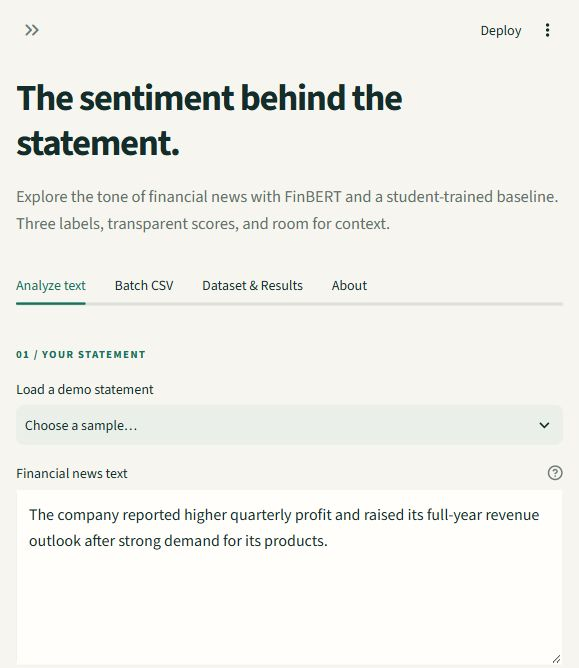
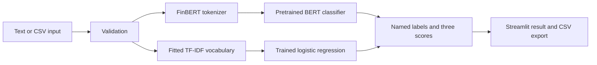

# Financial News Sentiment Analysis with FinBERT

**[Launch the live app](https://financial-sentiment-akshatog.streamlit.app/)**

[](https://github.com/akshatog/financial-sentiment-finbert)
[](https://github.com/akshatog/financial-sentiment-finbert/actions/workflows/tests.yml)

A Streamlit application that classifies short English financial statements as **positive**, **negative**, or **neutral**. It uses the pretrained [`ProsusAI/finbert`](https://huggingface.co/ProsusAI/finbert) transformer and a separately trained TF-IDF + logistic regression baseline.

**Unit 4 · Deep Learning Project**

**Akshat Agarwal** · Roll number **202401100100028** · Section **CS-5A**  
**KIET Group of Institutions, Ghaziabad** · Faculty: **Kriti Sharma**

> **What we trained:** the TF-IDF + logistic regression baseline. FinBERT uses downloaded pretrained weights without further training in this project. FinBERT was already fine-tuned on Financial PhraseBank, so its PhraseBank scores are an overlapping-data diagnostic, not an independent test or a fair comparison with the baseline's held-out result.

**Fine-tuning next:** a separate [Colab training workflow](docs/FINETUNING.md) is prepared for `yiyanghkust/finbert-pretrain` with a new sentiment head and full encoder fine-tuning. GPU execution and final metrics are pending. The deployed app and reported results above still describe the completed original models.

## Features

- Analyse a financial sentence and inspect all three model scores.
- Analyse a CSV file and download row-level results.
- Switch between FinBERT and the trained baseline.
- Inspect the data audit and saved evaluation evidence.
- Run locally with project-local model and package caches.



The local interface provides text analysis, batch CSV analysis, and a separate dataset/results view.

## Quick start on Windows

Open PowerShell in the project directory. Python 3.13 is the development environment. The bootstrap script creates a project-local virtual environment and installs the specified dependencies.

```powershell
python scripts/bootstrap.py
.\.venv\Scripts\Activate.ps1
python -m scripts.prepare_data
python -m scripts.train_baseline
python -m scripts.evaluate
streamlit run app.py
```

If PowerShell blocks activation, use the virtual environment executable directly. No execution-policy change is necessary:

```powershell
.\.venv\Scripts\python.exe -m scripts.prepare_data
.\.venv\Scripts\python.exe -m scripts.train_baseline
.\.venv\Scripts\python.exe -m scripts.evaluate
.\.venv\Scripts\python.exe -m streamlit run app.py
```

The first FinBERT load downloads its tokenizer and weights from Hugging Face. Allow time for that download and keep the app running. Later launches reuse the project cache. Run the transformer diagnostic separately:

```powershell
.\.venv\Scripts\python.exe -m scripts.evaluate --finbert
```

## Demo

Try these short, self-authored examples. Their sentiment labels are intended demonstrations, not independently annotated evaluation data:

```text
The company reported higher profit and raised its full-year guidance.
The company expects an operating loss after demand weakened.
The company will publish its annual report on Friday.
```

Upload [the example CSV](data/examples/demo_news.csv) for the batch workflow. It contains eight self-authored examples including an intentionally blank row. Select the text column in the interface. The app accepts UTF-8 CSV files up to 2 MB and 500 rows, preserves original columns, and adds `prediction`, `model_score`, `score_positive`, `score_neutral`, `score_negative`, `status`, and `error` columns. FinBERT rejects text exceeding 512 tokenizer tokens, including special tokens, instead of silently truncating it. See [the demo guide](docs/DEMO_GUIDE.md) for a short presentation script and troubleshooting.

## Architecture



The reusable prediction layer keeps model inference separate from the interface. The transformer reads label names from its configuration instead of assuming that numeric class orders match the dataset. The baseline keeps vectorization and classification in one saved scikit-learn pipeline.

## Dataset and experiment

We use [Financial PhraseBank](https://huggingface.co/datasets/takala/financial_phrasebank), the `Sentences_50Agree` configuration. Its 4,846 raw rows contain 2,879 neutral, 1,363 positive, and 604 negative statements. The agreement threshold describes agreement between human annotators, not prediction confidence. The other agreement subsets overlap this source and are not separate test sets.

The preparation script groups text using Unicode NFKC normalization, case folding, and collapsed whitespace. It quarantines entire groups with conflicting labels and removes repeated occurrences from matching groups. It then saves the cleaned data and a reproducible stratified 70/15/15 train/validation/test split with seed 42. No normalized duplicate text crosses partitions. TF-IDF fits on training text only. Validation chooses the baseline settings before the test set is evaluated.

The generated files under `outputs/` record the measured audit and evaluation results. The table below draws directly from those files.

<!-- RESULTS_START -->
The audit retained **4,836 clean sentences** after removing 6 matching duplicate occurrences and quarantining 4 rows in conflicting-label groups. The saved split contains **3,385 training / 725 validation / 726 test** examples, with zero normalized sentence overlap.

### Held-out baseline test

| Model | Accuracy | Macro F1 | Test examples |
| --- | ---: | ---: | ---: |
| Majority class (neutral) | 59.37% | 24.83% | 726 |
| TF-IDF + logistic regression | **75.76%** | **71.94%** | 726 |

Validation selected **C = 2**, with **11,138 TF-IDF features** fitted on training text only. These are results for our independently trained baseline on the saved PhraseBank test partition.

### FinBERT diagnostic with prior training exposure

FinBERT achieved 88.15% accuracy and 87.51% macro F1 on 726 PhraseBank examples. **The checkpoint was already fine-tuned on Financial PhraseBank.** These values are a diagnostic with known dataset-level training exposure, not independent accuracy or a fair unseen-data comparison against the baseline.

Evidence: [dataset audit](outputs/dataset_audit.json), [training metadata](models/baseline_metadata.json), [evaluation metrics](outputs/evaluation.json), and [results detail](docs/RESULTS.md).
<!-- RESULTS_END -->

Accuracy measures the fraction of correct predictions. Macro F1 gives each class equal weight and helps expose poor performance on the smaller negative class. Confusion matrices show the types of mistakes. See [methodology](docs/METHODOLOGY.md) for split construction, metric interpretation, and leakage limitations.

## Reproduce the evidence

```powershell
.\.venv\Scripts\python.exe -m scripts.prepare_data
.\.venv\Scripts\python.exe -m scripts.train_baseline
.\.venv\Scripts\python.exe -m scripts.evaluate
.\.venv\Scripts\python.exe -m scripts.evaluate --finbert
```

The saved audit, split membership, baseline artifact, predictions, and metrics provide the evidence behind the presentation. The evaluator reuses a saved test result when the model and split fingerprints match. Its `--force` option explicitly repeats that evaluation. Running the same pipeline with the same dependencies and seed should reproduce the data partition and baseline experiment. Hardware and numerical-library differences may affect timing or very small floating-point values.

Public reports contain aggregate counts and record IDs. Raw sentences, cleaned data, splits, and row-level errors remain in ignored local files. The preparation script downloads and verifies the source archive so a fresh checkout can recreate them.

To install the test tools and run the focused checks:

```powershell
python scripts/bootstrap.py --dev
.\.venv\Scripts\python.exe -m pytest -q
```

## Project layout

```text
app.py                    Streamlit interface
src/                      Shared data and prediction logic
scripts/                  Bootstrap, preparation, training and evaluation
data/                     Downloaded data, saved splits and demo input
models/                   Locally trained baseline
outputs/                  Audit, predictions, metrics and figures
docs/                     Methodology, demo and viva notes
presentation/             Editable PowerPoint and slide source
tests/                    Focused checks
```

## Limits and responsible interpretation

- Sentiment describes the financial statement. It does not forecast a share price or give investment advice.
- Model scores are softmax or classifier scores, not a measured guarantee of correctness. This project does not calibrate them.
- English financial sentences are the intended input. Long documents, other languages, sarcasm, mixed events, and statements needing context can produce misleading labels.
- A random split measures performance on the cleaned PhraseBank sample. It does not prove performance on future news, other markets, or unseen companies.
- FinBERT has prior PhraseBank training exposure. Its diagnostic score must remain visibly separated from the baseline's held-out score.
- An independent source-linked, human-reviewed test has not been completed. Synthetic demo sentences do not replace it.

Thirty source-linked paraphrased candidate sentences are prepared in [the review sheet](data/review/candidates.csv). A human reviewer must fill every `human_label` before seeing predictions, following [the review instructions](data/review/README.md). Only after that review, run `python -m scripts.evaluate_review`. The script rejects incomplete labels, checks exact normalized PhraseBank overlap, and freezes the reviewed file fingerprint. These curated examples span four sources and remain a small, correlated check rather than a broad benchmark.

## Submission materials

- [Editable presentation](presentation/financial_sentiment_revised.pptx)
- [Methodology and evaluation policy](docs/METHODOLOGY.md)
- [Live demo guide](docs/DEMO_GUIDE.md)
- [Viva questions and answers](docs/VIVA_GUIDE.md)
- [Third-party attribution](docs/ATTRIBUTION.md)
- [Deployment instructions and current hosting status](docs/DEPLOYMENT.md)
- [Delivery checklist](docs/STATUS.md)

## Licenses and references

Original project source uses the [MIT License](LICENSE). Third-party data and model weights have separate terms. The FinBERT model card currently lists **CC BY-NC-SA 4.0** for its weights. Financial PhraseBank lists **CC BY-NC-SA 3.0**. This repository's MIT license does not relicense those assets. See [attribution](docs/ATTRIBUTION.md) before redistributing data or weights.

- [FinBERT model card and training-data disclosure](https://huggingface.co/ProsusAI/finbert)
- [Araci (2019), FinBERT](https://arxiv.org/abs/1908.10063)
- [Financial PhraseBank dataset card](https://huggingface.co/datasets/takala/financial_phrasebank)
- [Devlin et al. (2018), BERT](https://arxiv.org/abs/1810.04805)

