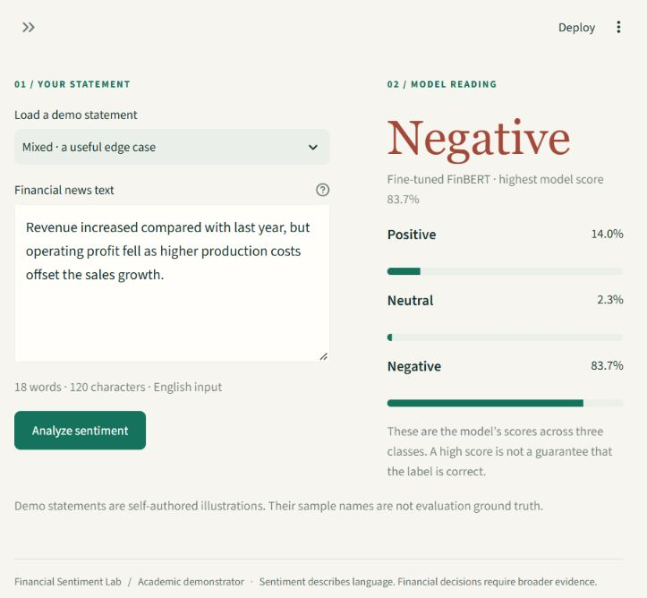
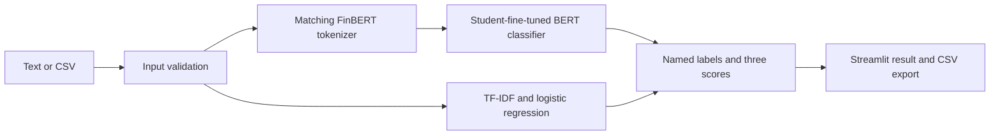

# Financial News Sentiment Analysis Using FinBERT

**[Launch the live app](https://financial-sentiment-akshatog.streamlit.app/)**

[](https://github.com/akshatog/financial-sentiment-finbert)
[](https://github.com/akshatog/financial-sentiment-finbert/actions/workflows/tests.yml)

A Streamlit application that classifies short English financial statements as **positive**, **negative**, or **neutral**. Its main model is **our fine-tuned HKUST FinBERT**, trained from [`yiyanghkust/finbert-pretrain`](https://huggingface.co/yiyanghkust/finbert-pretrain). A trained TF-IDF + logistic regression baseline and the original Prosus FinBERT reference support comparison.

**Unit 4 · Deep Learning Project**
**Akshat Agarwal** · Roll number **202401100100028** · Section **CS-5A**
**KIET Group of Institutions, Ghaziabad** · Faculty: **Kriti Sharma**

> **What we trained:** all **109,754,115 parameters** of HKUST FinBERT with a new three-class sentiment head, plus the TF-IDF + logistic regression baseline. The fine-tuned model achieved **85.12% accuracy and 84.46% macro-F1 on 726 held-out examples**. The original `ProsusAI/finbert` remains a pretrained reference; it already used Financial PhraseBank for sentiment fine-tuning, so its corpus score is a diagnostic with prior exposure.

The [Colab training workflow](docs/FINETUNING.md) completed on a Tesla T4. The returned weights, data fingerprints, evaluation bindings, and actual encoder update were verified, and the model loaded locally. See [delivery status](docs/STATUS.md) for hosted-app verification.

## Features

- Analyse a financial sentence and inspect all three scores.
- Upload a CSV, preserve row-level validation errors, and download predictions.
- Choose **Fine-tuned FinBERT**, **Prosus FinBERT reference**, or **TF-IDF baseline**.
- Inspect the dataset audit, training evidence, and saved evaluation results.
- Run locally with project-local model and package caches.



## Quick start on Windows

Open PowerShell in the project directory. The development environment uses Python 3.13. The bootstrap script creates a project-local environment and installs the CPU app dependencies.

```powershell
python scripts/bootstrap.py
.\.venv\Scripts\python.exe -m streamlit run app.py
```

The fitted conventional baseline is included in the repository. The first fine-tuned model request obtains the checksum-verified project artifact if it is absent locally. Keep the app open during that download. The optional Prosus reference downloads its pinned public snapshot from Hugging Face. No paid model API key is required. **Training is already complete; launching the app does not require a new Colab run.**

## Demo

Try these self-authored examples. Their intended sentiment is a demonstration, not independently annotated accuracy evidence:

```text
The company reported higher profit and raised its full-year guidance.
The company expects an operating loss after demand weakened.
The company will publish its annual report on Friday.
```

Upload [the example CSV](data/examples/demo_news.csv) for the batch workflow. It contains eight self-authored rows including an intentional blank. The app accepts UTF-8 CSV files up to 2 MB and 500 rows, preserves original columns, and adds `prediction`, `model_score`, `score_positive`, `score_neutral`, `score_negative`, `status`, and `error` columns.

**Fine-tuned FinBERT accepts 128 tokenizer tokens**, including special tokens. The Prosus reference accepts 512. The app rejects longer inputs instead of silently truncating them. See [the demo guide](docs/DEMO_GUIDE.md).

## Architecture



The prediction layer reads label names from each model's configuration. Our fine-tuned classifier uses negative=0, neutral=1, positive=2; this differs from the Prosus class order. Explicit model selection never silently substitutes a different checkpoint.

## Dataset and measured results

We use [Financial PhraseBank](https://huggingface.co/datasets/takala/financial_phrasebank), `Sentences_50Agree.txt`. The 4,846 raw rows contain 2,879 neutral, 1,363 positive, and 604 negative statements. Agreement describes agreement between human annotators, not prediction confidence. The other agreement subsets overlap this source and are never combined as independent data.

The audit groups sentences using Unicode NFKC normalization, case folding, and collapsed whitespace. It quarantines all conflicting-label groups and keeps one instance from matching duplicate groups before a stratified split with seed 42.

<!-- RESULTS_START -->
The audit retained **4,836 clean sentences**, removing 6 matching duplicate occurrences and quarantining 4 conflicting rows. The fixed split contains **3,385 training / 725 validation / 726 test** examples with zero normalized sentence overlap.

| Model | Test accuracy | Test macro-F1 | Correct / total |
| --- | ---: | ---: | ---: |
| Majority class (neutral) | 59.37% | 24.83% | 431 / 726 |
| TF-IDF + logistic regression | 75.76% | 71.94% | 550 / 726 |
| **Fine-tuned HKUST FinBERT** | **85.12%** | **84.46%** | **618 / 726** |

FinBERT trained for **3 epochs and 636 optimizer steps** on a Tesla T4 in **470.172 seconds** (about 7 minutes 50 seconds). Validation macro-F1 selected **epoch 2, checkpoint 424**, with validation macro-F1 **81.92%**. The held-out gains over TF-IDF are **9.37 percentage points accuracy** and **12.52 points macro-F1**, or 68 more correct predictions. These describe one saved corpus split, not guaranteed future-news performance or statistical significance.

**Separate Prosus diagnostic:** the original `ProsusAI/finbert` scored 88.15% accuracy and 87.51% macro-F1 on the same 726 examples. Its prior sentiment fine-tuning used Financial PhraseBank, so this is **not a fair unseen-data comparison** with either student-trained model. HKUST FinBERT is a different starting checkpoint; absence of overlap with its large pretraining corpus has not been established.
<!-- RESULTS_END -->

Evidence: [dataset audit](outputs/dataset_audit.json), [baseline metadata](models/baseline_metadata.json), [fine-tuning manifest](outputs/finetuning/training_manifest.json), [training history](outputs/finetuning/training_history.json), [fine-tuned test metrics](outputs/finetuning/evaluation.json), [verified import](outputs/finetuning/import_verification.json), and [detailed results](docs/RESULTS.md).

## Reproduce the experiment

To reproduce preparation and the conventional baseline:

```powershell
.\.venv\Scripts\python.exe -m scripts.prepare_data
.\.venv\Scripts\python.exe -m scripts.train_baseline
.\.venv\Scripts\python.exe -m scripts.evaluate
```

The evaluator reuses matching saved test results. `--force` deliberately records a repeated evaluation. The optional `python -m scripts.evaluate --finbert` command evaluates the Prosus reference as a separately labelled diagnostic.

For the full transformer recipe, use [the Colab notebook](notebooks/finetune_finbert_colab.ipynb) and [fine-tuning instructions](docs/FINETUNING.md). GPU training dependencies are separate from the CPU app. A deliberate reproduction is a new run selected using validation data; do not tune settings against the reported test result.

Raw sentences, splits, private errors, environments, and large transformer weights are excluded from Git. Public evidence contains aggregate counts and hashes. The preparation script downloads and verifies the dataset archive so a fresh checkout can reconstruct the fixed split.

To run the focused checks:

```powershell
python scripts/bootstrap.py --dev
.\.venv\Scripts\python.exe -m pytest -q
```

## Project layout

```text
app.py          Streamlit interface
src/            Data, model, inference and artifact-loading logic
scripts/        Preparation, training, evaluation and export
notebooks/      Colab fine-tuning workflow
data/           Ignored dataset files plus demo and review inputs
models/         Baseline artifact and ignored local transformer weights
outputs/        Aggregate audit, training and evaluation evidence
docs/           Methodology, results, deployment and viva notes
presentation/   Editable PowerPoint and slide source
tests/          Focused checks
```

## Limits

- Sentiment describes a statement; it does not predict stock returns or give investment advice.
- Softmax and classifier scores are not calibrated guarantees of correctness.
- English financial sentences are the intended input. Mixed events, missing context, sarcasm, other languages and domain shift can cause errors.
- A random PhraseBank split does not establish temporal independence, entity independence, or performance on future news.
- The Prosus diagnostic has known dataset exposure. Unknown overlap with HKUST's pretraining corpus remains a limitation.
- The independent human-reviewed check remains pending. The 30 source-linked candidates in [the review sheet](data/review/candidates.csv) must be labelled before predictions, following [the review protocol](data/review/README.md). Demo sentences do not replace that evaluation.

## Submission materials and references

- [Editable presentation](presentation/financial_sentiment_finetuned.pptx)
- [Methodology](docs/METHODOLOGY.md), [results](docs/RESULTS.md), [demo guide](docs/DEMO_GUIDE.md), and [viva guide](docs/VIVA_GUIDE.md)
- [Deployment](docs/DEPLOYMENT.md), [delivery status](docs/STATUS.md), and [attribution](docs/ATTRIBUTION.md)
- [HKUST checkpoint](https://huggingface.co/yiyanghkust/finbert-pretrain) and [authors' fine-tuning example](https://github.com/yya518/FinBERT/blob/master/finetune.ipynb)
- [Prosus checkpoint](https://huggingface.co/ProsusAI/finbert) and [Araci (2019)](https://arxiv.org/abs/1908.10063)
- [Financial PhraseBank](https://huggingface.co/datasets/takala/financial_phrasebank) and [BERT](https://arxiv.org/abs/1810.04805)

Original project source uses [MIT](LICENSE). Third-party data and weights retain their separate terms. The Prosus card lists CC BY-NC-SA 4.0 and PhraseBank lists CC BY-NC-SA 3.0; these must not be assumed to describe HKUST's separate checkpoint. This repository's MIT license does not relicense those assets.
