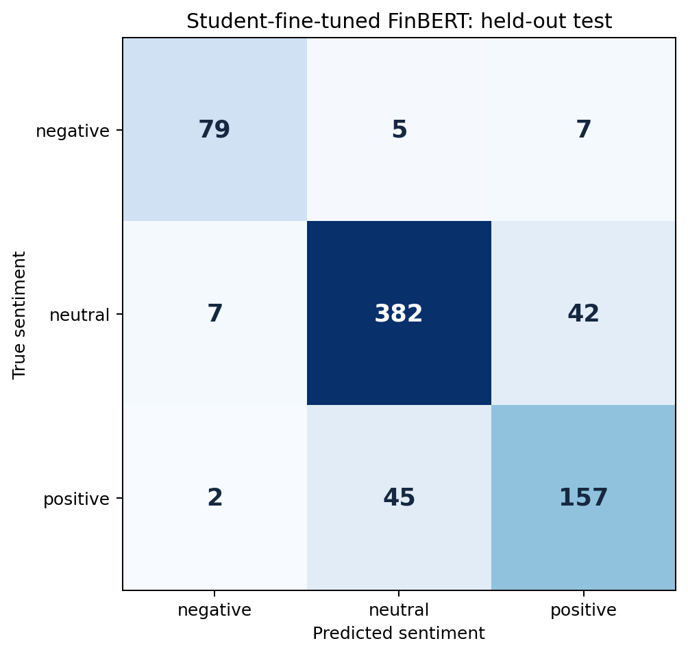

# Measured results

The fixed, deduplicated Financial PhraseBank split contains **3,385 training, 725 validation, and 726 test** sentences. All student model training uses the training partition; model selection uses validation only. The full dataset audit retains 4,836 rows after removing six matching duplicates and quarantining four conflicting rows.

## Held-out comparison

| Model | Accuracy | Macro-F1 | Correct / test |
| --- | ---: | ---: | ---: |
| Majority class (neutral) | 59.37% | 24.83% | 431 / 726 |
| TF-IDF + logistic regression | 75.76% | 71.94% | 550 / 726 |
| **Fine-tuned HKUST FinBERT** | **85.12%** | **84.46%** | **618 / 726** |

The fine-tuned model gains **9.37 percentage points accuracy** and **12.52 points macro-F1** over the conventional baseline, with **68 more correct** classifications. This is a descriptive comparison on one fixed split; statistical significance and generalization to future news are not established.

## Completed transformer training

The starting model was `yiyanghkust/finbert-pretrain`, revision `88ab954a39ea6d3ce2b62cff086dd5ad1172c664`, with a newly initialized three-class sentiment head. All **109,754,115 parameters** were trainable. Training completed on a **Tesla T4**, with **3 epochs, 636 optimizer steps**, learning rate **2e-5**, microbatch **2**, accumulation **8**, effective batch **16**, and maximum length **128**. FP16, dynamic padding and gradient checkpointing limited memory use. Total recorded elapsed time was **470.172 seconds**.

| Epoch | Validation accuracy | Validation macro-F1 | Validation loss |
| --- | ---: | ---: | ---: |
| 1 | 84.00% | 81.40% | 0.4197 |
| **2 — selected** | **84.28%** | **81.92%** | **0.3946** |
| 3 | 84.00% | 81.87% | 0.4766 |

Validation selected **checkpoint 424 from epoch 2**. The final validation entry in the history reevaluates that reloaded best checkpoint after epoch 3; its epoch field reflects the completed training schedule. It is not a fourth training epoch. Falling training loss alongside the slightly weaker epoch 3 validation result supports keeping the selected checkpoint rather than adding epochs based on test performance.

No training or test sentence exceeded the 128-token limit. One validation sentence was right-truncated. The test evaluator records **one evaluation**, without an explicit repeat. File hashes bind its metrics to the selected returned weights and tokenizer. The import check verified all ten exported members, matched split fingerprints, recomputed metrics from the confusion matrix, checked the saved encoder tensor against training evidence, and loaded the classifier locally. Three self-authored local inference checks were behavior checks, not another accuracy benchmark.

## Fine-tuned per-class test results

| Class | Precision | Recall | F1 | Support |
| --- | ---: | ---: | ---: | ---: |
| negative | 89.77% | 86.81% | 88.27% | 91 |
| neutral | 88.43% | 88.63% | 88.53% | 431 |
| positive | 76.21% | 76.96% | 76.59% | 204 |

Rows below contain true labels; columns contain predictions.

| Actual / predicted | negative | neutral | positive |
| --- | ---: | ---: | ---: |
| negative | 79 | 5 | 7 |
| neutral | 7 | 382 | 42 |
| positive | 2 | 45 | 157 |

The model makes **108 errors**. Positive/neutral confusion accounts for **87** of them (80.6%). These counts identify where errors concentrate without proving their cause. Positive sentiment has the weakest per-class F1 in this run.

## Baseline evidence

Validation selected logistic-regression **C=2**, with **11,138 TF-IDF features** fitted on training text only. The conventional model makes 176 test errors. Its class F1 values are 69.27% negative, 82.53% neutral, and 64.02% positive.

## Separate Prosus reference diagnostic

The original `ProsusAI/finbert` gives **88.15% accuracy and 87.51% macro-F1** on these 726 PhraseBank examples. That checkpoint already received supervised PhraseBank sentiment training, so this is a diagnostic with known dataset exposure. It is not a fair unseen-data ranking against either student-trained model.

Our new training starts from a different HKUST financial language-model checkpoint. It removes that documented supervised benchmark exposure from the new experiment, but does not establish that every test sentence was absent from HKUST's large pretraining corpus. The independent human-reviewed check is still pending; no future-news accuracy claim is made.

## Evidence files

- [Dataset audit](../outputs/dataset_audit.json)
- [Baseline training metadata](../models/baseline_metadata.json) and [baseline/Prosus metrics](../outputs/evaluation.json)
- [Fine-tuning manifest](../outputs/finetuning/training_manifest.json) and [training history](../outputs/finetuning/training_history.json)
- [Frozen fine-tuned evaluation](../outputs/finetuning/evaluation.json)
- [Returned model verification](../outputs/finetuning/import_verification.json)
- [Independent review protocol](../data/review/README.md)
